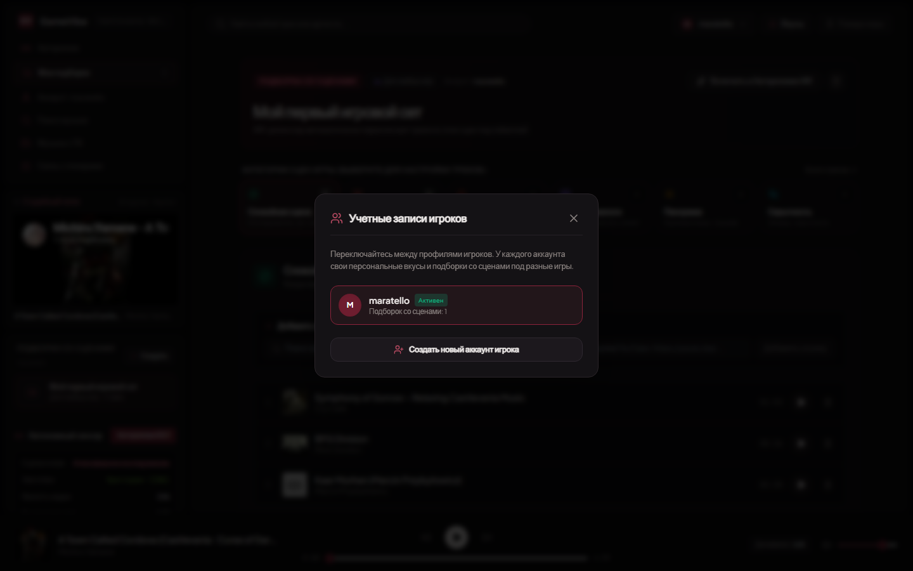

<div align="center">

  

  # GAMEMUSICK v2.0
  ### AI Sound Director & 50Hz Rust Adaptive Soundtrack Engine for PC Games

  **Нативное десктопное приложение для Windows: 50 Гц Rust-сенсор в реальном времени распознает ситуацию на экране игры (исследование, скрытность, битву, полоску HP босса, сюжетные катсцены и диалоги) и плавно переключает музыку — 100% бесплатно.**

  [-blue?style=for-the-badge&logo=windows)](https://github.com/maratello1/gamemusick/releases)
  [](https://github.com/maratello1/gamemusick)
  [](https://github.com/maratello1/gamemusick)
  [-emerald?style=for-the-badge)](LICENSE)

</div>

---

## ⚡ О проекте

**GameMusick v2.0** превращает любую ПК-игру в интерактивный кинематографичный саундтрек (как в *DOOM Eternal*, *The Witcher 3*, *Cyberpunk 2077* или *Elden Ring*), даже если сама игра этого не умеет.

Вместо того чтобы вручную переключать треки по `Alt+Tab` или слушать неподходящую музыку во время боссфайтов и сюжетных диалогов, **GameMusick** анализирует оптическую телеметрию кадра, ввод с клавиатуры/мыши/геймпада (XInput) и субтитры на экране — и автоматически управляет вашей музыкой.

---

## 🎮 Ключевые возможности v2.0

### 1. 🦀 Нативный 50 Гц Rust-сенсор (`interactive_sensor.exe`)
- Написан на чистом **Rust** с прямыми вызовами Win32 GDI (`BitBlt`), `GetAsyncKeyState` и динамической загрузкой `xinput1_4.dll` — работает без зависимостей от Python и с нулевой нагрузкой на CPU (< 0.5%).
- **Детектор полоски здоровья босса (`BOSSFIGHT`)**: автоматически распознаёт широкие красные/золотые/пурпурные индикаторы HP боссов в верхней и нижней части экрана, а также переводит затяжной интенсивный бой (> 18 сек) в фазу боссфайта.
- **Детектор широкоэкранных катсцен (`DRAMA`)**: мгновенно фиксирует появление черных кинематографичных полос (Letterbox 21:9) и субтитров.
- **Детектор скрытности (`STEALTH`)** и **открытия новых локаций (`MAJESTIC`)**: учитывает приседание (`Ctrl`/`C`) в темных зонах и резкую смену освещения при выходе на панораму.
- **100% безопасно для античитов** (*Easy Anti-Cheat, BattlEye, VAC, Vanguard*): сенсор не читает память игры (`ReadProcessMemory`) и не внедряет DLL.

### 2. 🧠 Непрерывная онлайн-эволюция локальной нейросети (Free Offline Neural Evolution)
- **Самообучение без подключения Gemini**: когда облачный API Gemini отключен, автономная локальная нейросеть обучается прямо во время вашей игры без каких-либо ключей или затрат.
- **Подстройка под темп каждой игры**: анализирует базовый уровень движения кадра, спектры красного урона и освещение, автоматически калибруя пороговые значения (`combatMotionThreshold`, `stealthLumaThreshold`) индивидуально под каждую запущенную игру.
- **Обучение с подкреплением (Reinforcement Learning)**: каждое ручное переключение сцены игроком или вызов горячей клавиши обучает модель — ИИ запоминает ваши предпочтения, подстраивает чувствительность и повышает точность (+30 XP к уровню нейросети).
- **Прямая синхронизация с 50 Гц Rust-сенсором**: обученные веса динамически считываются нативным сенсором в реальном времени.

### 3. 🎧 Плавный кроссфейд, память таймкода и Smart Dialogue Ducking
- **Бесшовный кроссфейд сцен**: при смене игровой ситуации старый трек плавно затухает (`fade-out`), а новый мягко нарастает (`fade-in`) без резких обрывов.
- **Память таймкода исследования (`⏪ Продолжение с mm:ss`)**: когда бой заканчивается, спокойный трек исследования продолжает играть ровно с той секунды, на которой его прервала схватка!
- **Умное приглушение под диалоги (`🔉 Диалог`)**: как только в нижней трети экрана появляются субтитры диалога, громкость музыки автоматически снижается до **42%**, чтобы вы четко слышали озвучку персонажей, и плавно возвращается к 100% после завершения реплики.

### 4. 🎭 Пользовательские подборки по 6 игровым сценам + Обмен с друзьями
Распределяйте любимые треки по 6 сценам:
- 🌿 **Спокойная сцена / Исследование (`EXPLORE`)**
- ⚔️ **Битва / Сражение (`COMBAT`)**
- 💀 **Битва с боссом / Апогей (`BOSSFIGHT`)**
- 🎬 **Драма и катсцены (`DRAMA`)**
- 🌄 **Величественная панорама (`MAJESTIC`)**
- 🌙 **Скрытность и напряжение (`STEALTH`)**
- **Экспорт и импорт в 1 клик**: делитесь своими сценарными плейлистами с друзьями через компактный код `GV2:...` или JSON-файл подборки.

### 5. 🖥️ Полноценное нативное приложение Windows + Игровой Мини-HUD
- Кастомное безрамочное окно с поддержкой сворачивания в **системный трей Windows** (музыка и ИИ-сенсор продолжают работать в фоне).
- **Игровой Мини-HUD (`Alt + M`)**: ультра-компактный плавающий виджет поверх игры с индикатором сцены, текущим треком и быстрым переключением 6 сцен.
- Изолированный локальный движок на порту `3001` с проверкой сигнатуры `/api/app-state`.

### 6. 🎵 100% Бесплатный Studio Audio Engine
- Воспроизведение **полных студийных версий треков** (с фильтрацией низкокачественных ремиксов и перезаливов) через встроенный YouTube Audio поток + кэширование.
- Поддержка локальной папки с вашей музыкой (`.mp3`, `.flac`, `.wav`, `.ogg`, `.m4a`).
- Опциональная синхронизация с системным медиа-плеером Windows (SMTC), Spotify и Яндекс Музыкой.

---

## 📸 Скриншоты интерфейса

<div align="center">
  
  <p><em>Панель непрерывного онлайн-обучения локальной нейросети: калибровка порогов боя под игру, уровни (XP), эпохи и журнал адаптаций</em></p>
</div>

<div align="center">
  
  <p><em>Редактор подборок со сценами: распределение треков под исследование, битвы, боссов и катсцены</em></p>
</div>

<div align="center">
  
  <p><em>Мульти-аккаунты и настройка музыкальных вкусов игрока</em></p>
</div>

---

## 🚀 Быстрый старт

### Вариант 1: Готовый лаунчер `GameMusick.exe` (Windows 10/11)
1. Скачайте последний релиз из раздела [**Releases**](https://github.com/maratello1/gamemusick/releases).
2. Запустите `GameMusick.exe` — приложение автоматически поднимет 50 Гц Rust-сенсор и откроет нативное окно **GameMusick Desktop**!

### Вариант 2: Сборка и запуск из исходного кода
Требования: [Node.js 18+](https://nodejs.org/) и Windows 10/11 (опционально `rustc` для пересборки нативных `.exe`).

```bash
# Клонировать репозиторий
git clone https://github.com/maratello1/gamemusick.git
cd gamemusick

# Установить зависимости
npm install

# Запустить нативное десктоп-приложение (Electron + 50Hz Rust Sensor)
npm run desktop

# Или запустить в режиме разработки на порту 3001
npm run dev
```

---

## ⌨️ Глобальные горячие клавиши в игре (In-Game Hotkeys)

Работают поверх любой полноэкранной или оконной игры:
- `Alt + 1` — Переключить сцену в **Спокойное исследование (`EXPLORE`)**
- `Alt + 2` — Переключить сцену в **Скрытность (`STEALTH`)**
- `Alt + 3` — Переключить сцену в **Сражение (`COMBAT`)**
- `Alt + 4` — Переключить сцену в **Битву с боссом (`BOSSFIGHT`)**
- `Alt + 5` — Переключить сцену в **Величественную панораму (`MAJESTIC`)**
- `Alt + M` — Переключить компактный **Игровой Мини-HUD**
- `Alt + P` — Закрепить окно **поверх игры (Always on Top)**

---

## 🛡️ Безопасность для античитов

GameMusick **не модифицирует файлы игр** и **не читает оперативную память процессов**:
- Оптический анализ выполняется исключительно через стандартный экранный буфер Windows GDI (аналогично OBS Studio, Discord Screen Share и NVIDIA ShadowPlay).
- Полностью совместимо с *Counter-Strike 2, Dota 2, Elden Ring, Cyberpunk 2077, Valorant, Apex Legends, Genshin Impact* и другими проектами.

---

<div align="center">
  <sub>Создано для геймеров · <b>GameMusick v2.0</b> · MIT License</sub>
</div>
