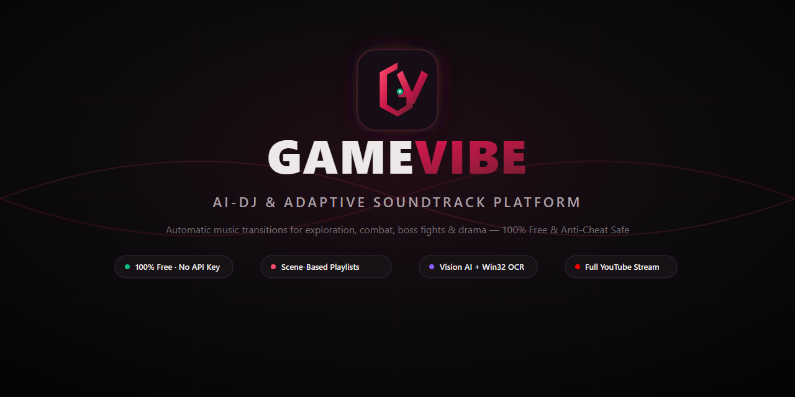
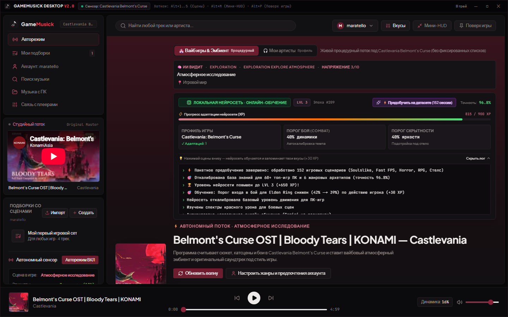
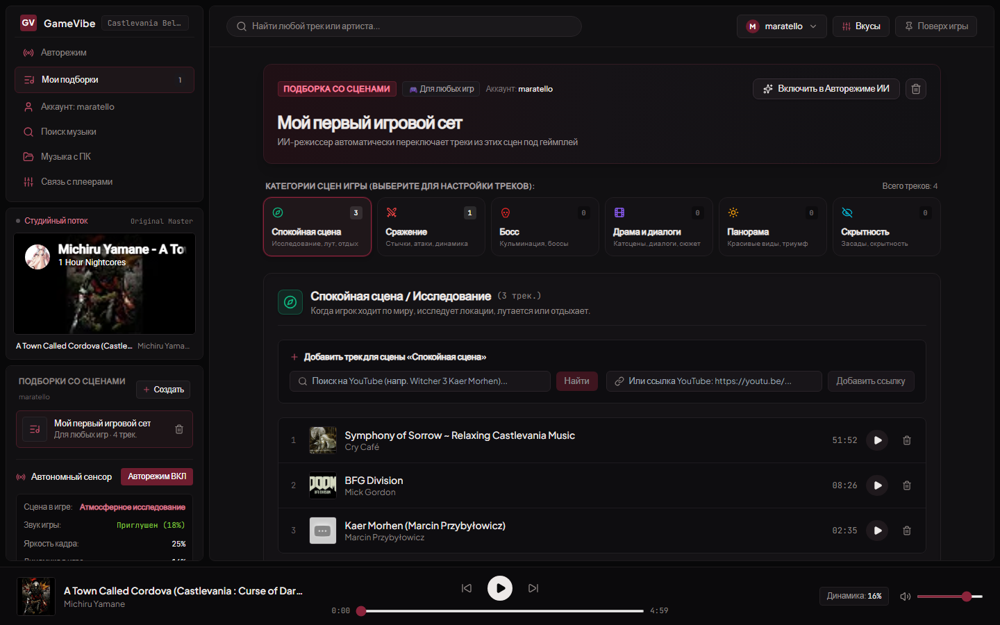

<div align="center">

  

  # GAMEMUSICK v3.1
  ### Гибридный ИИ-звукорежиссёр для ПК-игр: Valve GSI · LoL/SC2/PoE/MC Мосты · CoreAudio WASAPI 50Hz · WinRT OCR · Gemini / Ollama / OpenRouter

  **GameMusick в реальном времени понимает, что происходит у вас на экране — от тихого меню и стелса до файта с боссом, постановки бомбы или трагической катсцены — и бесшовно подбирает музыку под ваш вкус или атмосферу игры.**

  [](https://github.com/maratello1/gamemusick/releases)
  [-blue?style=for-the-badge&logo=windows)](https://github.com/maratello1/gamemusick/releases)
  [](https://github.com/maratello1/gamemusick)
  [](https://github.com/maratello1/gamemusick)
  [-emerald?style=for-the-badge)](LICENSE)

</div>

---

## ⚡ Что нового в GameMusick v3.1

1. **Нативный сенсор 50 Гц v3.1 (32×18 GDI DIB + Windows CoreAudio WASAPI)**:
   - В **48 раз меньше обращений к ядру Windows**: один проход `StretchBlt` + `GetDIBits` вместо 48 вызовов `GetPixel`, полная поддержка Per-Monitor DPI масштабирования (125%–200%) и приоритет активного окна.
   - **Живой аудит звука игры (`gameAudioPeak`)**: чистый COM WASAPI-мониторинг на уровне PID (игнорирует сам плеер и браузер, слышит только звук игры — отличает тихое меню от взрывов и перестрелок!).
   - **Защита от чёрных кадров DX12 (`captureBlocked`)**: полноэкранный DX12/Vulkan больше не вызывает ложный «хоррор».
2. **Native Game Bridges 2.0 — 6 игр без чтения памяти**:
   - **Dota 2 & Counter-Strike 2 (Valve GSI)** + **League of Legends Live Client Data API (`:2999`)** + **StarCraft II Local API (`:6119`)** + **Path of Exile 1/2 (`Client.txt`)** + **Minecraft (`latest.log`)**.
   - Точное определение лобби, пика/драфта, убежища/города, замесов, арены босса, низкого HP, респавна и победы.
3. **Неубиваемый аудиодвижок и настоящее самообучение RL**:
   - Защита кроссфейда от гонок (`playGenerationRef`), моментальный авто-скип битых/DMCA-заблокированных YouTube embed-видео (Error `100/101/150`) без штрафного понижения артиста в ИИ + автоматический переход на локальные треки или процедурный **`stemSynth`** при отсутствии сети.
   - **Вкус-ранжирование в `/api/ytmusic`**: дослушанные и лайкнутые артисты/жанры поднимаются вверх для конкретной игры, а дизлайки и недоступные видео строго фильтруются.
   - **Быстрые системные медиа-клавиши**: фоновый Win32 `keybd_event` воркер (`< 10 мс` вместо холодного запуска PowerShell), автоперезапуск упавших сенсоров в Electron и 👍 / 👎 оценки прямо в мини-оверлее **`Alt+M`**.

### Основа архитектуры (v3.0 — сохранена и улучшена в v3.1)

1. **Прощайте «6 жёстких настроений» — встречайте `SceneVector` (15+ семантических тегов)**:
   Вместо грубого деления только на 6 папок движок теперь оценивает непрерывный вектор **`energy / tension / valence`** и **15+ детальных тегов сцен** (`menu_lobby`, `cozy_hub`, `explore_wander`, `vista_wonder`, `horror_dread`, `stealth_infiltrate`, `dialogue_story`, `tragedy_drama`, `respawn_downtime`, `skirmish_combat`, `teamfight_clash`, `chase_escape`, `boss_climax`, `victory_triumph`).
2. **Официальная интеграция Dota 2 & CS2 (Valve GSI)** *(0% нагрузки на облако, 100% точность)*:
   Больше никаких ложных «эпических остов» в главном меню Доты! Игра сама по локальному HTTP (`127.0.0.1:3001/api/gsi`) сообщает точную фазу: меню/поиск, драфт, фарм, тимфайт, низкое HP, респавн, тикающая бомба, победа в раунде.
3. **Универсальный выбор ИИ-режиссёра («кто как хочет»)**:
   Во вкладке **«Связь с плеерами»** можно в один клик переключиться между **4 движками**:
   - **Локальный 50 Гц Rust + WinRT OCR** (полностью офлайн, бесплатно)
   - **Google Gemini (`gemini-3.5-flash-lite`, Free Tier)** (лучшее распознавание сюжетных сцен с умным кэшем дублей)
   - **Ollama — локальная VLM на вашем ПК** (`qwen3-vl:2b` / `qwen3.5:4b` / `gemma4:e4b` — ноль интернета и лимитов)
   - **OpenRouter / LM Studio / OpenAI-compatible API** (любой внешний или локальный VLM-сервер)
4. **Прямой промпт сцены и RL-обучение под вкусы игрока**:
   - Вводите описание любого желаемого настроения прямо в главном экране («мрачный эмбиент подземелья», «драйвовый фонк под тимфайт»).
   - Оценивайте треки кнопками **`В тему`** / **`Не под сцену`** — алгоритм переобучает веса выбора сцен и исключает неподходящие треки.
   - При включении режима **«Мои артисты»** программа ставит **только** ваших артистов и жанры, отфильтровывая игровые OST.

---

## 🎮 Сравнение режимов работы (выберите удобный вариант)

| Режим | Лучше всего подходит для | Интернет / Ключи | Нагрузка | Точность сцен |
| :--- | :--- | :---: | :---: | :---: |
| **1. Нативные мосты (6 игр)** *(Dota 2, CS2, LoL, SC2, PoE, MC)* | Киберспорт, MOBA, боссы ARPG, главное меню, бомба/респавн | Не нужны | ~0% CPU | **100% (официальные API/логи игры)** |
| **2. Google Gemini (`3.5-flash-lite`)** | Сюжетные ААА, RPG, инди, хорроры *(Witcher 3, Elden Ring, Cyberpunk, хорроры)* | Нужен бесплатный ключ AI Studio | 0% GPU | **~90–95%** (~3–5 ч/день бесплатно) |
| **3. Ollama (Локальная VLM)** | Сюжетные игры без интернета и без суточных лимитов | Нет (всё на вашем ПК) | ~2–4 ГБ VRAM | **~85–90%** |
| **4. Локальный 50 Гц + WinRT OCR** | Слабые ПК, шутеры, диалоги с субтитрами, быстрый старт без настроек | Не нужны | < 1% CPU | **~75–85%** |
| **5. OpenRouter / LM Studio API** | Продвинутые пользователи со своим API или кластером | Свой URL / ключ | 0% | Зависит от выбранной модели |

---

## 🛠️ Подробная инструкция по настройке каждого режима

### Вариант 1: Нативные мосты (Dota 2, CS2, LoL, StarCraft II, Path of Exile 1/2, Minecraft)

Никаких API-ключей и нейросетей не нужно — игры сами отдают точное состояние:
- **League of Legends / StarCraft II / Path of Exile 1-2 / Minecraft** подключаются **автоматически** без конфигов (локальные API `:2999`, `:6119` и безопасное чтение конца логов `Client.txt` / `latest.log`).
- Для **Dota 2** и **Counter-Strike 2** используется официальный Valve GSI:
1. Запустите **GameMusick** и откройте вкладку **«Связь с плеерами»**.
2. В блоке **«Native Game Bridges & GSI (6 игр без чтения памяти)»** нажмите **«Автоустановить GSI в Steam (1 клик)»**.
   - GameMusick автоматически найдёт Steam через реестр Windows + `libraryfolders.vdf` и создаст файл `gamestate_integration_gamemusick.cfg`.
3. **Если игра установлена в нестандартную папку** — установите конфиг вручную:
   - В том же блоке нажмите **«Ручная установка .cfg» -> «Копировать .cfg»** (или возьмите готовые файлы из папки `desktop/` репозитория):
     - **Dota 2**: сохраните как `gamestate_integration_gamemusick.cfg` в
       `Steam\steamapps\common\dota 2 beta\game\dota\cfg\`
     - **CS2**: сохраните как `gamestate_integration_gamemusick.cfg` в
       `Steam\steamapps\common\Counter-Strike Global Offensive\game\csgo\cfg\`
4. Перезапустите Dota 2 / CS2. В шапке GameMusick появится зелёный индикатор **`GSI · Dota 2`** или **`GSI · CS2`**, а в главном меню сразу включится спокойный фон из ваших артистов (или релакс-саундтрека).

---

### Вариант 2: Облачный ИИ Google Gemini (`gemini-3.5-flash-lite` Free Tier)
Отлично понимает атмосферу любых сюжетных игр: отличит уютную таверну от мрачной пещеры, тихую катсцену от панорамного вида или хоррора. В v3.0 встроен **фильтр статичных кадров**: скриншот `640px` отправляется только при реальной смене сцены или текста субтитров + автооткат `429` с fallback на локальный сенсор.
1. Перейдите в [Google AI Studio -> API Keys](https://aistudio.google.com/app/apikey) и создайте бесплатный ключ (`Create API key`).
2. Откройте в GameMusick вкладку **«Связь с плеерами»**.
3. В блоке **«ИИ-режиссёр: выбор движка (4 режима)»** выберите карточку **Google Gemini Vision**.
4. Вставьте ваш ключ (`AIzaSy...`), модель оставьте `gemini-3.5-flash-lite` и нажмите **«Проверить и сохранить»**.

---

### Вариант 3: Полностью локальная нейросеть через Ollama (без лимитов и облака)
Если у вас есть видеокарта с 4+ ГБ VRAM (RTX 3050 / 4060 / 3060 и выше):
1. Установите [Ollama](https://ollama.com/download) на Windows.
2. Откройте терминал и скачайте компактную мультимодальную VLM-модель:
   ```bash
   ollama pull qwen3-vl:2b
   # Или более точную версию для видеокарт с 6–8+ ГБ VRAM:
   ollama pull qwen3.5:4b
   ```
3. В GameMusick перейдите во вкладку **«Связь с плеерами»**, нажмите **Ollama (Локальная VLM)**.
4. Убедитесь, что адрес `http://127.0.0.1:11434/v1` и модель указаны верно, и нажмите **«Проверить Ollama и сохранить»**.

---

### Вариант 4: OpenRouter или свой OpenAI-совместимый API (LM Studio, vLLM, Groq)
1. В блоке выбора движка нажмите **OpenRouter / Custom API**.
2. Нажмите **«Пресет OpenRouter»** (укажет `https://openrouter.ai/api/v1`) или **«LM Studio / Custom OpenAI URL»** (укажет `http://127.0.0.1:1234/v1`).
3. Укажите ID Vision-модели (например, `google/gemini-2.5-flash-lite` или локальную модель из LM Studio) и, если нужно, API-ключ -> **«Проверить и сохранить»**.

---

### Вариант 5: Полностью офлайн (ничего не нужно настраивать)
Просто оставьте активным режим **«Локальный 50Hz + OCR»**.
Нативный сенсор на Rust + обновлённый `local_director.py` работают сразу «из коробки» с <1% нагрузки на процессор:
- **OpenCV-анализатор атмосферы (`< 2 мс` на кадр)**: различает тёплое освещение таверны/костра (`cozy_hub`), тёмную виньетку хоррора (`horror_dread`), открытый горизонт/небо (`vista_wonder`) и статичную UI-сетку инвентаря/паузы (`menu_lobby`).
- **Мультизонный WinRT OCR**: считывает субтитры (включая широкоэкранные катсцены `21:9`) для умного приглушения музыки под голос и определения драмы/триумфа по баннерам экрана (`YOU DIED`, `VICTORY`, `ПОБЕДА`).

---

## 🛡️ Почему Windows SmartScreen или браузер может писать про «вирус»?

**GameMusick полностью безопасен и открыт для проверки, код не содержит майнеров, стиллеров или вредоносных модулей.** Причины ложных срабатываний (False Positive) две:
1. **Отсутствие платной ЭЦП Microsoft Authenticode**: коммерческий сертификат подписи кода для независимых разработчиков стоит ~$300–500 в год. Любой неподписанный `.exe` на Rust/Electron при скачивании с GitHub помечается Windows Defender SmartScreen как «Неизвестный издатель».
2. **Эвристика антивирусов на игровой сенсор**: `interactive_sensor.exe` использует Win32 API для считывания динамики активного окна (`BitBlt`) и частоты нажатий боевых клавиш (`GetAsyncKeyState`). Некоторые эвристические сканеры автоматически настораживаются при виде этих API внутри неподписанного бинарника.

**Как запускать спокойно:**
- В Windows SmartScreen нажмите **«Подробнее» -> «Выполнить в любом случае»**.
- В Chrome/Edge при блокировке скачивания откройте **Загрузки (`Ctrl+J`) -> «Сохранить подозрительный файл»** *(или запускайте напрямую из открытого исходного кода — см. ниже)*.
- **Для полной прозрачности**: вы можете просмотреть весь исходный код [`desktop/interactive_sensor.rs`](desktop/interactive_sensor.rs) и [`desktop/local_director.py`](desktop/local_director.py) или собрать `.exe` самостоятельно командой `rustc`.

---

## 🚀 Запуск приложения (2 способа)

### Способ 1: Готовый пакет сенсора из Releases
Скачайте последний архив `GameMusick-Sensor-v3.1-Windows-x64.zip` из раздела [**Releases**](https://github.com/maratello1/gamemusick/releases) *(внутри сенсор CoreAudio WASAPI, локальный ИИ-режиссёр 6 игр и готовые `.cfg` для Dota 2 / CS2)*.

### Способ 2: Запуск полной версии из исходного кода (рекомендуется — без SmartScreen!)
Требования: **Windows 10/11 (x64)**, **[Node.js 18+](https://nodejs.org/)** и опционально **Python 3.10+** (для OCR / локальной ИИ-синхронизации).

```bash
# 1. Клонировать репозиторий
git clone https://github.com/maratello1/gamemusick.git
cd gamemusick

# 2. Установить зависимости
npm install

# 3. Запустить нативное десктоп-приложение (Electron + 50Hz Sensor + Local Director)
npm run desktop

# Или открыть веб-версию отдельно на http://localhost:3001
npm run dev
```

*(Дополнительно для пересборки сенсора на Rust при желании: `rustc -O desktop/interactive_sensor.rs -o desktop/interactive_sensor.exe`)*

---

## 📸 Скриншоты интерфейса

<div align="center">
  
  <p><em>Панель непрерывного онлайн-обучения локальной нейросети и калибровки сцен под каждую игру</em></p>
</div>

<div align="center">
  
  <p><em>Редактор подборок с привязкой к конкретным тегам сцен</em></p>
</div>

---

## ⌨️ Горячие клавиши поверх любой игры

- `Alt + 1` — Переключить сцену на **Исследование (`EXPLORE`)**
- `Alt + 2` — Переключить сцену на **Скрытность / Саспенс (`STEALTH`)**
- `Alt + 3` — Переключить сцену на **Сражение (`COMBAT`)**
- `Alt + 4` — Переключить сцену на **Боссфайты (`BOSSFIGHT`)**
- `Alt + 5` — Переключить сцену на **Панораму / Величие (`MAJESTIC`)**
- `Alt + M` — Показать / скрыть компактный **Игровой Мини-HUD**
- `Alt + P` — Закрепить окно **поверх всех окон (Always on Top)**

---

## 🔒 Безопасность в онлайн-играх и античитах

- **Ноль вмешательства в процесс игры**: нет инъекций DLL, нет хуков DirectX/Vulkan, нет чтения оперативной памяти (`ReadProcessMemory`).
- **Dota 2 & CS2**: работает через официальный документированный механизм Valve **Game State Integration (`.cfg`)**.
- **Другие онлайн-игры**: оптический захват кадров через системный буфер Windows GDI (аналогично OBS Studio). При включённом режиме киберспорта автоматически снижает громкость музыки в замесах (`Clutch Ducking`), чтобы вы слышали шаги и тиммейтов.

---

<div align="center">
  <sub>Создано для геймеров · <b>GameMusick v3.1</b> · MIT License</sub>
</div>
